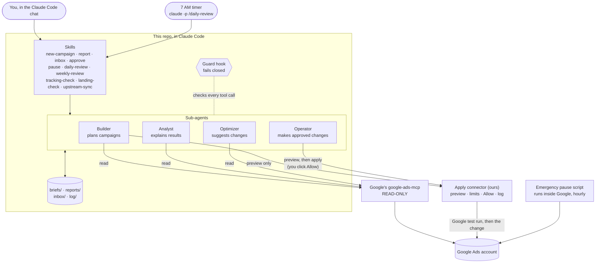
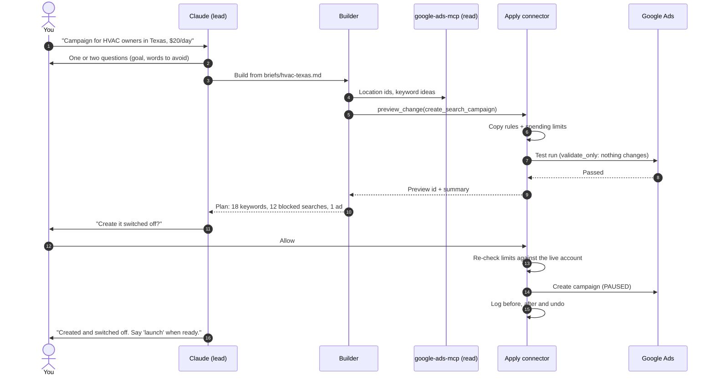
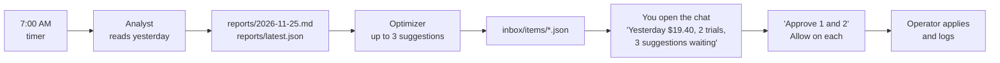
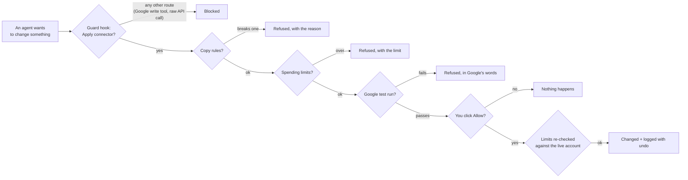

# Google Ads Automation for CaughtLeads

Run Google Ads from a Claude Code chat. You type what you want in plain English, a skill picks it up, and four AI
sub-agents do the work. **Nothing that spends money or changes an ad happens until you click Allow.**

It runs on a Claude Code plan: no Anthropic API key, no per-use AI bill.

| You type | What happens | Your click? |
|---|---|---|
| "Make a campaign for HVAC owners in Texas, $20 a day, send them to caughtleads.com/hvac" | The Builder plans it and Google test-runs it | **Allow** to create it (switched off), **Allow** again to launch |
| "How did ads do yesterday?" | The Analyst answers in plain English | No |
| "What's waiting for me?" | The Optimizer's suggestions, numbered, each with its reason | No |
| "Approve 1 and 2, skip 3" | The Operator makes those changes | **Allow** on each |
| "Pause everything" | Done at once. Stopping spend is always safe | No |
| "Is it set up?" | The setup checker lists what is ready and what is missing | No |
| "Turn on the daily check" | A 7 AM review on this computer that only reads and suggests | No |

---

## How it works



**The key idea:** the agents can read everything, but they have only one way to change the account: the Apply
connector. Claude Code asks you to **Allow** every use of it. It test-runs every change with Google first and
refuses anything over your spending limits, even after you click Allow.

### Creating a campaign, step by step



### The daily rhythm



Timed runs can only **read and suggest**: the timer starts Claude Code with the Apply tool's write tools
disallowed, and nobody is there to click Allow. Every change waits in the inbox for you.

---

## Safety, in code (not just instructions)



| Rail | Where |
|---|---|
| Agents only read: Google's connector is read-only three ways (its `tools_config.yaml`, denied write tools, and the guard allows only its three read tools) | `google-ads-mcp/tools_config.yaml`, `.claude/settings.json`, `.claude/hooks/guard.py` |
| One way to change the account, with an **Allow** prompt every time | `apply/`, `"ask"` in `.claude/settings.json` |
| Google test run (`validate_only`) before every change | `apply/core.py` |
| Daily cap, monthly cap (Google can spend up to 2x a daily budget in one day, so the month is tracked separately), biggest new-campaign budget, at most +20% budget a week with 7 days between raises. While the caps are 0, nothing can spend | `settings/limits.json` |
| New campaigns and new ads start switched off | `apply/gateway.py` |
| Copy rules: no "answers every call", "appointment" not "job", no revenue or outcome promises, no "TCPA", no "!" or shouting | `settings/copy_rules.json`, `apply/copy_rules.py` |
| Previews live in memory only: nothing on disk can be edited into an approval | `apply/core.py` |
| Google's read connector runs at one pinned commit, never "whatever is newest" | `.mcp.json`, `upstream/sources.json` |
| Every change logged with before, after and its undo | `log/changes.jsonl` |
| Emergency pause inside Google, hourly: works with every laptop off, and only ever pauses | `google-scripts/emergency-pause.js` |
| The guard fails closed, and Claude Code's "skip permissions" mode is disabled | `.claude/hooks/guard.py`, `.claude/settings.json` |
| Agents can't read the sign-in, or edit the limits, rules, settings or Apply code | `.claude/hooks/guard.py` |

---

## Setup

You need [Claude Code](https://claude.com/claude-code), [uv](https://docs.astral.sh/uv/),
[pipx](https://pipx.pypa.io/), the [gcloud CLI](https://cloud.google.com/sdk/docs/install) and Python 3.11+.

```bash
git clone https://github.com/hari9618/Google-Adds-Automation.git
cd Google-Adds-Automation
uv sync
uv run python tools/doctor.py        # what is ready, what is missing (never prints a secret)
```

1. **Google Cloud project** with the Google Ads API enabled, and an OAuth client of type *Desktop app*
   (APIs & Services > Credentials). Download its JSON.
2. **Developer token:** Google Ads manager account > Tools > API Center. A new token starts at test access;
   apply for **Basic** access for live accounts and for Keyword Planner.
3. **Apply connector sign-in.** In a terminal, not through Claude:
   ```bash
   uv run python tools/google_signin.py --client-secrets path/to/oauth-client.json
   # add --login-customer-id 1234567890 if access goes through a manager account
   ```
   It opens Google's sign-in, asks for the developer token without showing it, and writes
   `secrets/google-ads.yaml` (git-ignored, blocked from every agent).
4. **Read connector sign-in** (Google's google-ads-mcp):
   ```bash
   gcloud auth application-default login \
     --scopes=https://www.googleapis.com/auth/adwords,https://www.googleapis.com/auth/cloud-platform \
     --client-id-file=path/to/oauth-client.json
   ```
   Set `GOOGLE_APPLICATION_CREDENTIALS` to the path gcloud prints and `GOOGLE_CLOUD_PROJECT` to your project
   id (and `GOOGLE_ADS_LOGIN_CUSTOMER_ID` for a manager account).
5. **Account and limits:** the 10-digit customer id in `settings/account.json`; the daily cap, monthly cap and
   biggest new-campaign budget in `settings/limits.json`.
6. **Emergency pause:** set `CONFIG.EMAILS` in `google-scripts/emergency-pause.js`, paste it into Google Ads >
   Tools > Bulk actions > Scripts, Authorize, Preview, then schedule it **hourly**.
7. **Check:** `uv run python tools/doctor.py --live` reads the account once to prove the sign-in works.
8. **Open the folder in Claude Code** and say *"how did ads do yesterday?"*. Optional: *"turn on the daily check"*.

---

## What's in the repo

```
CLAUDE.md                  the product, the copy rules, "never change the account directly"
.mcp.json                  two connectors: google-ads (Google's, read-only) and apply (ours)
.claude/
  agents/                  builder · operator · analyst · optimizer
  skills/                  new-campaign · report · inbox · approve · pause · daily-review · weekly-review · daily-check
                           tracking-check · landing-check · upstream-sync
  hooks/                   guard.py (fails closed) · startup_summary.py (one line when the chat opens)
  settings.json            allow reads · ASK for apply_change · deny Google's write tools · hooks
apply/                     the Apply connector: an MCP server on Google's google-ads library (API v26)
settings/                  limits.json · copy_rules.json · account.json   (a person edits these)
google-ads-mcp/            tools_config.yaml (switches off the connector's write tools)
google-scripts/            emergency-pause.js (runs inside Google Ads, hourly)
scripts/                   daily-check.ps1 / daily-check.sh (the 7 AM timer: Windows, Mac, Linux)
tools/                     doctor.py · google_signin.py · inbox.py
upstream/                  sources.json (the repos we built from, pinned) · reports/ (what changed, weekly)
.github/workflows/         tests.yml (every push and PR) · upstream-sync.yml (Mondays)
tests/                     70 tests: limits, copy rules, previews, undo, pause, the guard, Google request building, upstream sync
briefs/ inbox/ reports/ log/   working files (git-ignored: they hold real campaign data)
```

### The Apply connector's tools

| Tool | What it does | Needs Allow? |
|---|---|---|
| `preview_change` | Checks copy rules and limits, test-runs with Google, returns what would change | No (changes nothing) |
| `apply_change` | Makes a previewed change; re-checks the limits first; logs it with an undo | **Yes, every time** |
| `pause_campaigns` | Switches campaigns off now (all live ones if none named) | No (stopping spend is safe) |
| `undo_change` | Previews the reverse of a logged change (then `apply_change` + Allow) | No (changes nothing) |
| `recent_changes` | The latest logged changes | No |

Changes it understands: `pause_campaign`, `enable_campaign`, `set_daily_budget`, `add_negative_keywords`,
`create_search_campaign`, `add_responsive_search_ad`.

---

## Develop

```bash
uv run pytest
uv run ruff check .
```

To edit the protected files (limits, rules, settings, `apply/`) from inside Claude Code, start it from a shell
with `CL_ADS_DEV=1`. Never use that for day-to-day running.

## Keeping it current

This repo was built from other people's repos (Google's Ads tools, Claude Code, several ads skill
sets; the full list is in [`upstream/sources.json`](upstream/sources.json)). Every Monday
[`upstream-sync.yml`](.github/workflows/upstream-sync.yml) checks whether any of them changed in the
files we care about. If so, it opens **one** pull request with a plain report: what changed, and
which of our files came from it. It changes none of our files and never merges itself. Run
`/upstream-sync` in Claude Code on that branch to adapt our skills and agents, let the tests pass,
then merge. Details: [`upstream/README.md`](upstream/README.md).

Google's read connector runs at the **exact commit** pinned in `.mcp.json`, so a new connector tool
(some of them change the account) can only arrive through that reviewed pull request. Python
packages are bumped by Dependabot.

## Not built yet

- **Measurement** (in the CaughtLeads app, not here): the Google tag on caughtleads.com and the ad click id
  saved with every signup. Until then the Analyst reports clicks and cost, not trials.
- **Closing the loop:** sending trials and paid customers back to Google (Data Manager API) from the
  CaughtLeads backend, nightly, so Google's bidding learns which clicks become customers.

## Built on

[googleads/google-ads-python](https://github.com/googleads/google-ads-python) (the Apply connector's engine) ·
[googleads/google-ads-mcp](https://github.com/googleads/google-ads-mcp) (reading the account) ·
[anthropics/claude-code](https://github.com/anthropics/claude-code) (skills, sub-agents, hooks, Allow prompts) ·
[modelcontextprotocol/python-sdk](https://github.com/modelcontextprotocol/python-sdk) (the MCP server)
